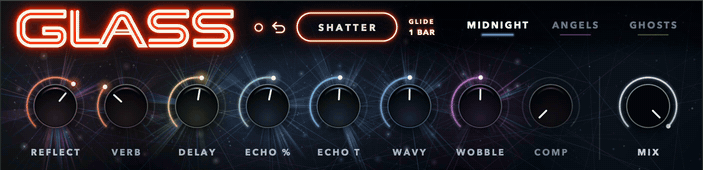

<p align="center">
  
</p>

<p align="center">
  
  
  
  
  
  
</p>

---

## GLASS 2.0 is out

Version 2 is a rebuilt face with more to play. Get it from the
[**Releases**](https://github.com/andrewmfoster/Glass/releases/latest) page.


### New in 2.0

- **MIX.** Blends the dry signal back in.
- **Preset bank.** Save your own, rename and delete them, put any of them on
  three slots. Shared by every Live set.
- **BACK.** Steps back through your last 16 SHATTERs and preset loads.
- **HOLD.** Click a knob's label and SHATTER leaves that knob where it is.
- **GLIDE.** Knobs travel to their new values in time with the song, from an
  eighth note to four bars.
- **SHATTER from a key or pad.** Map one in Live and play SHATTER by hand.
- **Fine control.** Hold Shift while dragging a knob for ten times finer
  travel.
- **Saved with the set.** Held knobs and the glide length come back when the
  Live set reloads.
- **PULSE.** The face glows with what you play into it. The LED left of BACK
  turns it off. Its strength follows MIX.

SHATTER with GLIDE on 1 BAR, in Live:



Coming from 1.0? Install both new files. The new device is made for the new
rack.

## What GLASS is

A custom-GUI **Max for Live** device for the **GLASS** Audio Effect Rack, an
original Ableton rack I built and sound-designed.

GLASS (the rack) chains Ableton's stock effects (Resonator, Phaser, Hybrid
Reverb, Grain Delay, Glue Compressor, Echo, Delay) into one instrument, with
hand-mapped macros driving the whole thing.

Ableton gives every rack the same plain generic macro panel. This device
replaces that with a bespoke shattered-glass interface. Stock effects still do
all the audio, GLASS knobs drive macros by index via the Live Object Model
(LOM).

## What it does

- **9 knobs.** Eight drive the sound. **MIX** sits apart and blends the dry signal
  back in. Drag to set. Hold Shift while dragging for ten times finer travel.
  Double-click a knob to center it; double-click MIX for all wet.
- **3 preset slots over one bank.** The bank starts with MIDNIGHT, ANGELS and
  GHOSTS, then holds your own. The caret at the end of a slot's color line opens
  the bank: pick a preset, save the current knobs as a new one, rename it, or
  delete it. Your presets live in `~/Documents/GLASS Presets.json` and are
  shared by every Live set.
- **SHATTER** randomizes the eight sound knobs and breaks the glass behind them
  into a fresh palette on each press. It never moves MIX.
- **BACK**, the arrow left of SHATTER, steps back through the last 16 SHATTERs
  and preset loads.
- **HOLD.** Click a knob's label to hold. A held knob stays where it is when you
  SHATTER. Loading a preset still moves every knob.
- **GLIDE** makes SHATTER, preset loads and BACK move the knobs over time
  instead of jumping: OFF, 1/8, 1/4, 1/2, 1 BAR, 2 BARS or 4 BARS at the song's
  tempo.
- **SHATTER from a key or pad.** The rack's tenth macro is named SHATTER. The
  button on the face can't be mapped, so show the rack's macros (the top button
  on the rack's left edge), then map a key, a pad or a knob to SHATTER in Live's
  MIDI map mode. Each press fires one SHATTER; a pad that also sends on
  release fires one on release too.
- **Value-reactive drawing.** Each knob's burst of glass grows, brightens and
  turns with its value; the whole field and the neon sign light up with overall
  rack energy.

### In Ableton

The device sits inside the GLASS rack in a live set:


## Requirements

- **Ableton Live 12 Suite.** The rack uses Echo and Hybrid Reverb, which come
  with Suite, and Suite includes Max for Live.
- The **GLASS** Audio Effect Rack with its macros mapped (ships as a bundle
  with `GLASS.adg`, or map your own rack's macros to match the table below).

## Download

Version 2.0 ships as a bundle on the
[**Releases**](https://github.com/andrewmfoster/Glass/releases/latest) page
(`GLASS.zip` → `Glass.amxd`, `GLASS.adg`, `GLASS.png` and `README.txt`).

## Install

The bundle holds four files: the device (`Glass.amxd`), the rack (`GLASS.adg`),
the GLASS icon (`GLASS.png`) and a readme (`README.txt`). You install the first
two. The rack **already contains the device** as its first chain device. It
just looks for `Glass.amxd` in your User Library. Install the device first,
then load the rack (no manual placement needed):

1. **Install the device.** Copy `Glass.amxd` into your Ableton User Library at
   `Presets/Audio Effects/Max Audio Effect/Imported/` (create the folders if
   they don't exist). Find the User Library via *Live → Preferences → Library*,
   or right-click **User Library** in Live's browser → *Show in Finder/Explorer*.
2. **Load the rack.** Double-click `GLASS.adg` (or drag it onto a track). The
   full rack loads on MIDNIGHT with its macros mapped and the GLASS device
   already inside it, bound automatically. (First load takes a few seconds
   while Max boots.)

If the device shows as *missing* in the rack, `Glass.amxd` isn't in your User
Library yet. Redo step 1 and reload `GLASS.adg`.

### Use it in your own rack

Using the bundled GLASS rack? Skip this, it's already set up.

The device drives its parent rack's macros **by index**, so it works in any
Audio Effect Rack. Drop `Glass.amxd` in as the **first device inside** your rack,
before your effects so PULSE hears what you play (this is "Option A": it
walks up to its parent rack to grab the macros), and map the macros to match the
[macro map](#macro-map-for-custom-racks) below. Only the first eight are needed. Without a ninth
there is no MIX, without a tenth no SHATTER from a pad, and without 11 to 14
holds, the glide length and PULSE reset when the set reloads.

GLASS reads macros 10 to 14 and writes 11 to 14, so leave them free for it.

## Macro map, for custom racks

The bundled rack already has all of this mapped. This is the reference for
building your own.

The device targets macros **by index** (macro *i* = rack parameter *i+1*;
range 0 to 127). Knobs are laid out in display order, which is *not* index order:

| Knob position (L→R) | Macro index | Rack macro | Name      |
|---------------------|-------------|------------|-----------|
| 1 | 0 | 1 | Reflect   |
| 2 | 7 | 8 | Verb      |
| 3 | 1 | 2 | Delay     |
| 4 | 2 | 3 | Echo %    |
| 5 | 3 | 4 | Echo Time |
| 6 | 4 | 5 | Wavy      |
| 7 | 5 | 6 | Wobble    |
| 8 | 6 | 7 | Comp      |
| 9 | 8 | 9 | MIX       |

All knobs display as `%` (the underlying macro range is 0 to 127).

Five more macros carry no knob on the face:

| Macro index | Rack macro | Name    | What it holds |
|-------------|------------|---------|---------------|
| 9  | 10 | SHATTER | Fires SHATTER each time its value crosses the middle. Map a key or pad here. |
| 10 | 11 | HOLD A  | Which of macros 1 to 4 are held. |
| 11 | 12 | HOLD B  | Which of macros 5 to 8 are held. |
| 12 | 13 | GLIDE   | The glide length, 0 (OFF) to 6 (4 BARS). |
| 13 | 14 | PULSE   | Whether the face pulses: 0 is on, 1 is off. The LED left of BACK sets it. |

Macros 11 to 14 are how holds, the glide length and PULSE get saved with the
set. They don't need to show in the rack, and the bundled rack hides them. The
rack's random button and its macro variations skip macros 10 to 14.

## Good to know

- **Pads owned by a controller script.** If a pad won't take a mapping, the
  controller's script is keeping it. Tick **Remote** for that controller's
  input port in Live's MIDI settings and try again.
- **A mapped key or pad gives up its normal job** in that set. A drum pad mapped
  to SHATTER no longer plays its drum.
- **One preset bank for every set.** A preset saved, renamed or deleted in one
  set changes in all of them.
- **The bank file is made by your first save.** Until then there is no
  `GLASS Presets.json`.
- **A failed save says so only in the Max console.** The preset still works
  until the device is closed.
- **Esc doesn't close the preset list or the glide list.** Click anywhere off
  the list instead.
- **The preset bank has not been run on Windows.**

## Project layout

```
Glass/
├── glass.jsui.js              the device: drawing + mouse + LOM (single jsui script)
├── sprites/                   baked images the script draws (wordmark, neon, shards, glows)
├── glass-*test.jsui.js        throwaway probes of what jsui can do inside Live
├── icon/                      app icon (64 to 1024px) + GitHub social banner
├── screenshots/               device + in-Ableton captures
├── mockups/                   the HTML mocks the face was ported from, a browser
│                              stand-in that drives the script, and build-banner.py
├── package.sh                 assembles the download bundle (scrubs the preset's
│                              absolute paths, then zips the device + rack + readme)
├── README.md · LICENSE · .gitignore
```

All logic lives in `glass.jsui.js`. The `.amxd` is a binary container that
references the script; once **frozen**, the script and its images bundle into
the device so it no longer depends on Max's search path.

The playable device (`Glass.amxd`) and the rack preset (`GLASS.adg`) aren't in
the repo. They ship together as a downloadable bundle. The repo holds the
source script and assets.

## License

[MIT](LICENSE) © 2026 Andrew Foster
