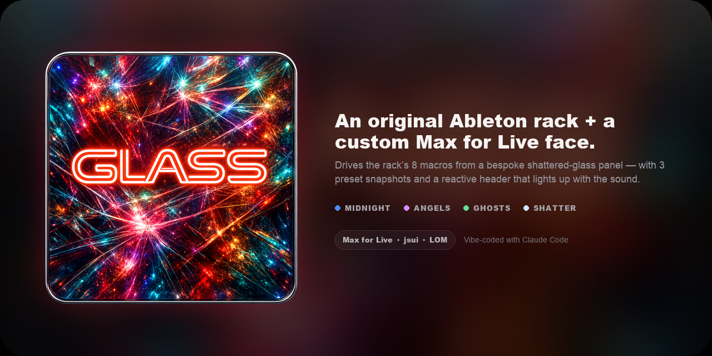
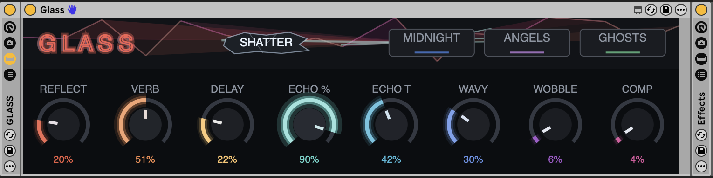
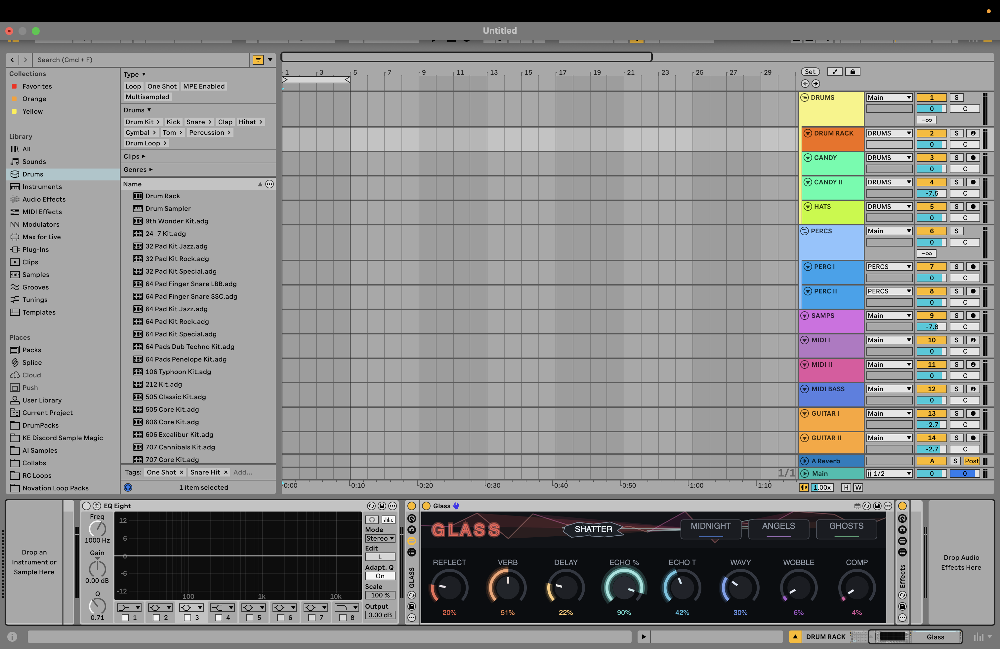

<p align="center">
  
</p>

<p align="center">
  
  
  
  
  
  
</p>

---

A custom-GUI **Max for Live** device for the **GLASS** Audio Effect Rack, an
original Ableton rack I built and sound-designed.

GLASS (the rack) chains Ableton's stock effects (Resonator, Phaser, Hybrid
Reverb, Grain Delay, Glue Compressor, Echo, Delay) into one instrument, with 8
hand-mapped macros driving the whole thing.

Ableton gives every rack the same plain generic macro panel. This
device replaces that face with a bespoke shattered-glass interface.
It's a thin control surface: the stock effects still do all the audio, while
its 8 knobs drive the rack's 8 macros by index via the Live Object Model (LOM).



## What it does

- **8 knobs**, one per rack macro: Reflect · Delay · Echo % · Echo Time ·
  Wavy · Wobble · Comp · Verb. Drag to set; the value is written straight to
  the macro, so knob → macro → sound is live.
- **3 preset snapshots** — MIDNIGHT / ANGELS / GHOSTS — recall the real saved
  macro values and re-theme the shard header per preset.
- **SHATTER** — randomises all 8 macros and regenerates a fresh header
  palette + crack geometry on each press.
- **Value-reactive drawing** — knob glow and hue-heat charge with value; the
  header shards/cracks light up with overall rack energy; a slow shimmer
  tracks the hovered knob.

### In Ableton

The device sits inside the GLASS rack in a live set — a wide letterbox panel in
the device chain, driving the rack's macros in real time:



## Requirements

- **Ableton Live Suite**, or Live + the **Max for Live** add-on (plus Max).
- The **GLASS** Audio Effect Rack with its 8 macros mapped (ship as a bundle
  with `GLASS.adg`, or map your own rack's macros to match the table below).

## Download

The playable device + rack preset ship as a bundle on the
[**Releases**](https://github.com/andrewmfoster/Glass/releases/latest) page
(`GLASS.zip` → `Glass.amxd`, `GLASS.adg`, and a readme).

## Install

The bundle is two files: the device (`Glass.amxd`) and the rack (`GLASS.adg`).
The rack **already contains the device** as its first chain device — it just
looks for `Glass.amxd` in your User Library. So install the device first, then
load the rack (no manual placement needed):

1. **Install the device.** Copy `Glass.amxd` into your Ableton User Library at
   `Presets/Audio Effects/Max Audio Effect/Imported/` (create the folders if
   they don't exist). Find the User Library via *Live → Preferences → Library*,
   or right-click **User Library** in Live's browser → *Show in Finder/Explorer*.
2. **Load the rack.** Double-click `GLASS.adg` (or drag it onto a track). The
   full rack loads with the 8 macros mapped and the GLASS device already inside
   it — bound automatically. (First load takes a few seconds while Max boots.)

If the device shows as *missing* in the rack, `Glass.amxd` isn't in your User
Library yet — redo step 1 and reload `GLASS.adg`.

### Use it in your own rack

The device drives its parent rack's 8 macros **by index**, so it works in any
Audio Effect Rack. Drop `Glass.amxd` in as the **first device inside** your rack
(this is "Option A" — it walks up to its parent rack to grab the macros) and map
the 8 macros to match the [macro map](#macro-map) below.

## Macro map

The device targets macros **by index** (macro *i* = rack parameter *i+1*;
range 0–127). Knobs are laid out in display order, which is *not* index order:

| Knob position (L→R) | Macro index | Name      |
|---------------------|-------------|-----------|
| 1 | 0 | Reflect   |
| 2 | 7 | Verb      |
| 3 | 1 | Delay     |
| 4 | 2 | Echo %    |
| 5 | 3 | Echo Time |
| 6 | 4 | Wavy      |
| 7 | 5 | Wobble    |
| 8 | 6 | Comp      |

All knobs display as `%` (the underlying macro range is 0–127).

## Project layout

```
Glass/
├── glass.jsui.js              — the device: drawing + mouse + LOM (single jsui script)
├── icon/                      — app icon (64–1024px) + GitHub social banner
├── screenshots/               — device + in-Ableton captures
├── mockups/build-banner.py    — regenerates the social banner from the icon
├── package.sh                 — assembles the download bundle (scrubs the preset's
│                                absolute paths, then zips the device + rack + readme)
├── README.md · LICENSE · .gitignore
```

All logic lives in `glass.jsui.js`. The `.amxd` is a binary container that
references the script; once **frozen**, the script bundles into the device so it
no longer depends on Max's search path.

The playable device (`Glass.amxd`) and the rack preset (`GLASS.adg`) aren't in
the repo — they ship together as a downloadable bundle. The repo holds the
source script and assets.

## License

[MIT](LICENSE) © 2026 Andrew Foster
